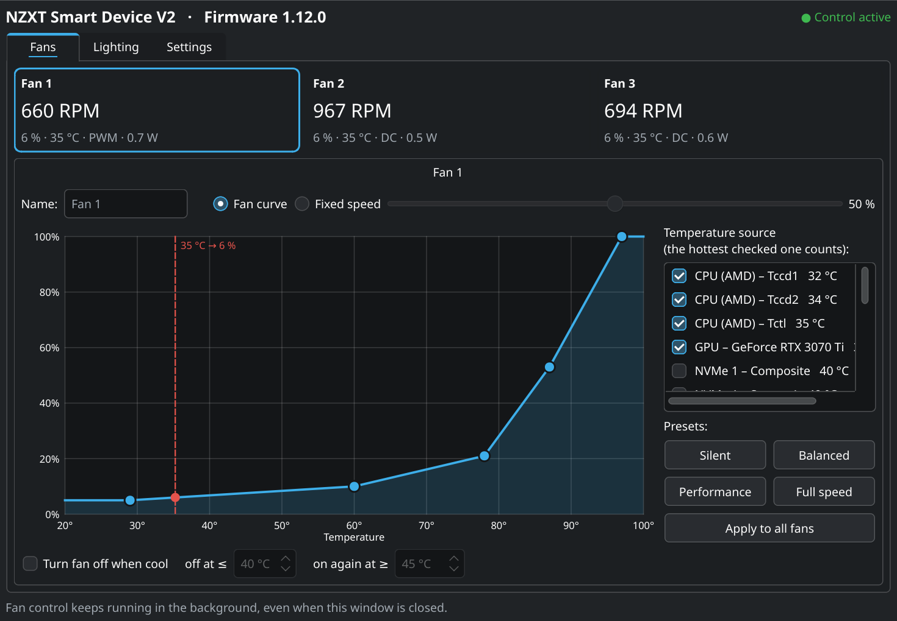
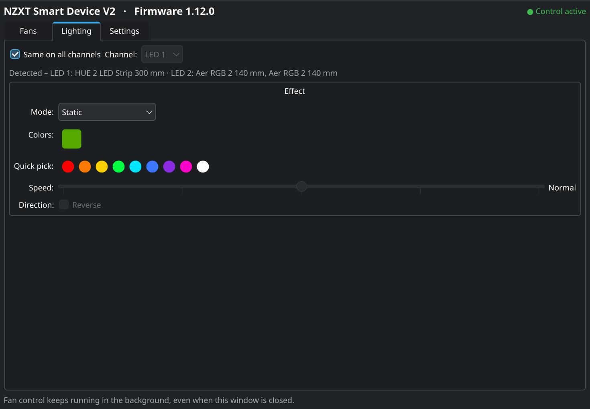

# CAM4LINUX
CAM4LINUX is a python library and software suite for controlling fans and lighting of NZXT
devices on Linux.

**This repository is a fork of [xvzf/cam4linux](https://github.com/xvzf/cam4linux) by Matthias
Riegler.** It builds on that project and has been developed further, among other things with
support for the NZXT Smart Device V2 / RGB & Fan Controller and a desktop app.

> **Disclaimer:** This is an independent community project. It is **not** an official NZXT
> product and is not affiliated with, endorsed, sponsored or supported by NZXT Inc. in any way.
> Please do not contact NZXT support about this software. NZXT, CAM and the product names
> mentioned here are trademarks of NZXT Inc. and are used only to describe compatibility.
> Use at your own risk: wrong fan settings can cause your hardware to overheat.

# SUPPORTED DEVICES
- NZXT Smart Device V2 (built into H510i/H510 Elite/H710i/H210i …) and NZXT RGB & Fan Controller
  (USB `1e71:2006`, `200d`, `200f`, `2009`, `200e`, `2010`), NZXT HUE 2 (lighting only)
- NZXT Grid (legacy serial backend in `backend/`, needs `pyserial`)

# CAM4LINUX APP
Desktop app (Qt/PySide6) with fan curves and lighting control:

<table>
  <tr>
    <td width="50%"></td>
    <td width="50%"></td>
  </tr>
  <tr>
    <td align="center"><b>Fan control</b></td>
    <td align="center"><b>Lighting</b></td>
  </tr>
</table>

- fan curves per fan (drag points, presets), or fixed speed
- temperature sources: CPU, GPU (NVIDIA via `nvidia-smi`, AMD via hwmon), NVMe, RAM, …
  – the hottest selected sensor counts, polled every second (configurable)
- fans ramp up immediately and down slowly (no audible pumping)
- LED effects and colors for both channels, connected accessories are detected
- runs as a systemd **user** service in the background, the GUI only edits the settings
- no root daemon: a udev rule grants the logged-in user access to the device
- UI in German and English (`cam4linux/lang/*.json`, follows the system language,
  falls back to English; can be changed in the settings)

Requirements: Linux ≥ 5.17 (`nzxt-smart2` driver), Python 3, PySide6
(`sudo pacman -S pyside6`).

**Install:** `./build.sh` creates `dist/cam4linux.pyz`, a single executable file. Double-click it
in the file manager: it installs itself for the current user (app menu entry, icon, autostart
service), asks once for the admin password to set up device access (polkit dialog) and starts
the app. Running a newer `.pyz` updates the installation. Afterwards start **cam4linux** from
the app menu.

Alternatives: `./install.sh` (same, from the source checkout), `./uninstall.sh` or
`cam4linux --uninstall`. Without installing: `python3 -m cam4linux` (GUI) or
`python3 -m cam4linux --daemon` from the repository root.

Settings: `~/.config/cam4linux/config.json`. Adding a language: copy `cam4linux/lang/en.json`
to `<code>.json` and translate the values.

The LED/fan protocol follows [liquidctl](https://github.com/liquidctl/liquidctl)'s SmartDevice2 driver.

# LICENSE
This program is distributed in the hope that it will be useful,
but WITHOUT ANY WARRANTY; without even the implied warranty of
MERCHANTABILITY or FITNESS FOR A PARTICULAR PURPOSE.  See the
GNU General Public License for more details.
